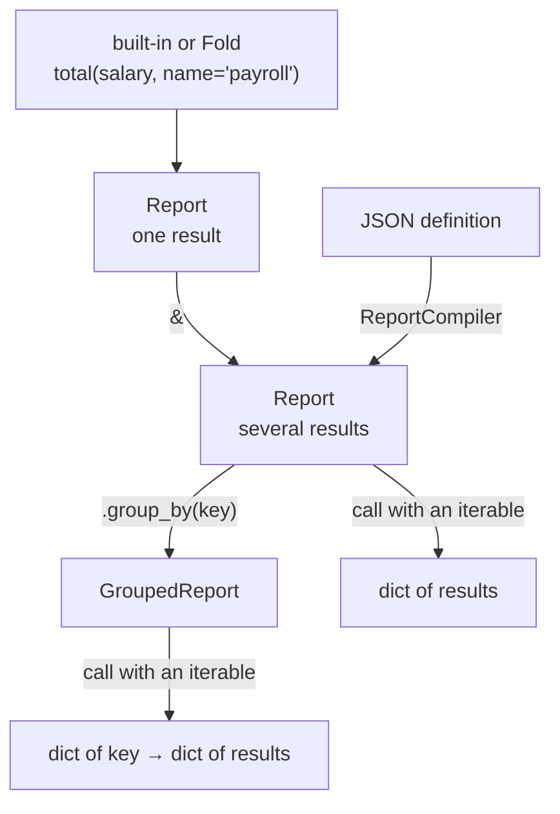

# User guide

pyaggregation has a handful of pieces. Each page covers one of them with examples you can
paste and run.

| Piece | What it is | Page |
| --- | --- | --- |
| `Report`, `&` | several aggregates run together, one dict out | [Reports and &](reports.md) |
| `total`, `count`, `average`, ... | the 19 built-in aggregates | [Built-in aggregates](builtins.md) |
| `where`, `share` | which items each aggregate sees | [Filtering and shares](filtering.md) |
| `group_by` | the same report per key, still in one pass | [Grouping](grouping.md) |
| `Decimal`, empty input, `None` | exact money and predictable edge cases | [Money, Decimal and edge cases](numbers.md) |
| `Fold`, `aggregate` | your own aggregate from three functions | [Your own aggregates](custom.md) |
| `ReportCompiler` | JSON definitions to reports | [Compiling reports from JSON](compiling.md) |
| `get_report_json_schema` | JSON Schema of the definitions a compiler accepts | [JSON Schema](json-schema.md) |

## The mental model



1. An **aggregate** is a named result: a fold over the value `of(item)` for every item that
   passes `where`.
2. Every built-in returns a **report** holding one aggregate.
3. Reports **join with `&`** into bigger reports. Nothing is computed yet.
4. Calling a report with an **iterable** reads each item once and returns a dict.

## The examples' data

Every example in the guide uses these employees and three accessor functions:

```python
from dataclasses import dataclass
from decimal import Decimal


@dataclass(frozen=True)
class Employee:
    name: str
    department: str
    salary: Decimal
    manager: bool = False


employees = [
    Employee("Alice", "Sales", Decimal("3000.00"), manager=True),
    Employee("Bob", "IT", Decimal("4500.50")),
    Employee("Carol", "Sales", Decimal("2500.25")),
    Employee("Dan", "IT", Decimal("5000.00"), manager=True),
    Employee("Eve", "IT", Decimal("4000.00")),
]


def salary(employee: Employee) -> Decimal:
    return employee.salary


def department(employee: Employee) -> str:
    return employee.department


def is_manager(employee: Employee) -> bool:
    return employee.manager
```

`of` and `where` are plain callables: a function, a lambda, `operator.attrgetter("salary")`,
a pyformula `Formula` or a pyspecification `Predicate` all work.
